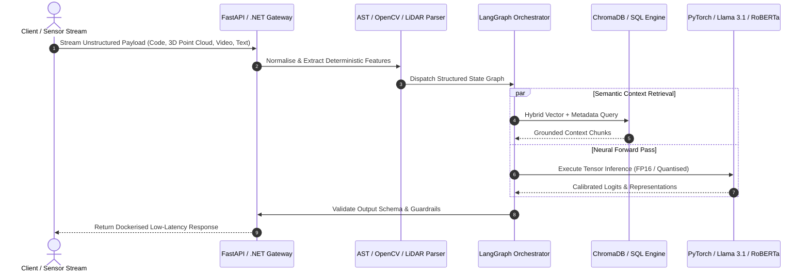
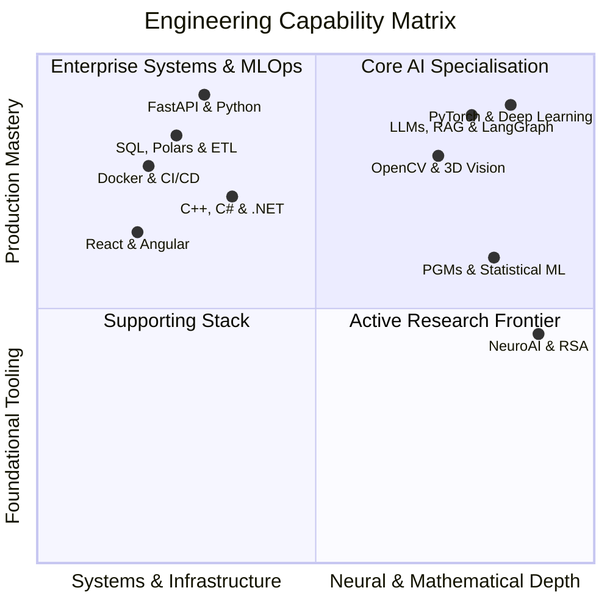

<div align="center">

  <!-- Dynamic Cyberpunk HUD Banner -->
  

  <!-- Hugging Face Style Model Card Metadata -->
  <p align="center">
    <a href="https://github.com/nithinreddy18"></a>
    <a href="https://www.tu-darmstadt.de/"></a>
    
    
    
  </p>

  <!-- Interactive Console Navigation -->
  <p align="center">
    <kbd><a href="#01-objective-function">01 // Objective Function</a></kbd> ·
    <kbd><a href="#02-live-inference-trace">02 // Inference Trace</a></kbd> ·
    <kbd><a href="#03-capability-quadrant">03 // Skill Tensors</a></kbd> ·
    <kbd><a href="#04-verified-benchmarks">04 // Benchmarks</a></kbd> ·
    <kbd><a href="#05-execution-logs">05 // Field Logs</a></kbd> ·
    <kbd><a href="#06-training-schedule">06 // Epochs</a></kbd> ·
    <kbd><a href="#07-api-endpoints">07 // API Endpoints</a></kbd>
  </p>

</div>

---

<a id="01-objective-function"></a>
### `01 // EXECUTIVE ABSTRACT & OBJECTIVE FUNCTION`

I am **Malluri Nithin Reddy**, an Artificial Intelligence and Machine Learning graduate engineer at **Technische Universität Darmstadt**. Most machine learning prototypes stall inside Jupyter notebooks. I engineer the missing bridge between mathematical research and resilient production software. 

With an industrial foundation building enterprise C++ and C# systems at **Siemens** and high-volume Python and SQL data pipelines at **Increff**, I design multi-agent Large Language Model workflows, 3D spatial computer vision pipelines, and containerised microservices that hold up under real-world load.

#### **The Personal Mission Directive**
My engineering philosophy is governed by a single optimisation problem that minimises the gap between theoretical model capacity and deterministic production reliability:

$$\min_{\theta} \mathcal{L}_{\text{system}}(\theta) = \underbrace{\alpha \cdot \mathcal{D}_{\text{KL}}\left(P_{\text{research}} \parallel Q_{\text{production}}\right)}_{\text{Zero-Hallucination Grounding}} + \underbrace{\beta \cdot \mathbb{E}\left[\text{Latency}_{\text{P99}}\right]}_{\text{Sub-Second Inference}} - \underbrace{\gamma \cdot \mathcal{I}\left(\text{Neural\_State}; \text{Human\_Intent}\right)}_{\text{NeuroAI \& Interpretability}}$$

> [!IMPORTANT]
> **Core Engineering Mandate**
> To transform high-dimensional neural architectures and unstructured data streams into transparent, self-correcting, and production-grade software systems that solve physical and enterprise challenges.

---

<a id="02-live-inference-trace"></a>
### `02 // LIVE INFERENCE TRACE: HOW I ARCHITECT SYSTEMS`

Instead of building isolated scripts, I treat every project as an end-to-end distributed system. Below is the execution trace of how raw multimodal data flows through my typical production stack.



---

<a id="03-capability-quadrant"></a>
### `03 // SKILL TENSORS & CAPABILITY QUADRANT`

<table width="100%">
  <tr>
    <td width="48%" valign="middle">



</td>
    <td width="52%" valign="top">
      <h4>⚙️ Explicit Tensor Specifications</h4>
      <p><b>🧠 Neural Architectures & GenAI</b><br>
      <code>PyTorch</code> <code>TensorFlow</code> <code>Keras</code> <code>Hugging Face</code> <code>LangChain</code> <code>LangGraph</code> <code>Llama 3.1</code> <code>RoBERTa</code> <code>LSTM</code> <code>Scikit-learn</code></p>
      <p><b>👁️ Spatial Vision & NeuroAI</b><br>
      <code>OpenCV</code> <code>MediaPipe</code> <code>3D LiDAR Point Clouds</code> <code>Net2Brain</code> <code>Representational Similarity Analysis</code></p>
      <p><b>⚡ High-Throughput Data & Backends</b><br>
      <code>Python</code> <code>C++</code> <code>C#</code> <code>FastAPI</code> <code>ASP.NET Core</code> <code>Polars</code> <code>Pandas</code> <code>NumPy</code> <code>SQL</code> <code>ChromaDB</code></p>
      <p><b>☁️ MLOps, Cloud & Interfaces</b><br>
      <code>Docker</code> <code>GitHub Actions</code> <code>Azure Data Factory</code> <code>Google Cloud</code> <code>React</code> <code>Angular</code> <code>Git</code></p>
    </td>
  </tr>
</table>

---

<a id="04-verified-benchmarks"></a>
### `04 // VERIFIED PRODUCTION BENCHMARKS (PROJECT SHOWCASE)`

Every repository is engineered to solve a concrete bottleneck. Click any **system inspection drawer** below to examine the underlying architecture.

<table>
  <tr>
    <td width="50%" valign="top">
      <h4><code>SYS-01</code> 🚲 UniBike Fleet & Repair Analytics</h4>
      <p>
        
        
      </p>
      <p><code>Pipeline:</code> <code>Telemetry → ChromaDB → Llama 3.1 → React UI</code></p>
      <p>Full-stack mobility intelligence platform featuring an autonomous RAG agent for automated bike repair diagnostics, fleet tracking, and predictive maintenance workflows.</p>
      <details>
        <summary><kbd>▶ Inspect System Architecture & Specs</kbd></summary>
        <br>
        <ul>
          <li><b>Vector Engine:</b> Indexed technical repair manuals and historical ticket logs in ChromaDB for grounded semantic retrieval.</li>
          <li><b>Backend & DevOps:</b> Asynchronous FastAPI microservices paired with automated GitHub Actions CI/CD pipelines.</li>
        </ul>
      </details>
      <p align="right"><a href="https://github.com/nithinreddy18?tab=repositories"><kbd>↗ Launch Repository</kbd></a></p>
    </td>
    <td width="50%" valign="top">
      <h4><code>SYS-02</code> 📄 AST-Driven AI Documentation Engine</h4>
      <p>
        
        
      </p>
      <p><code>Pipeline:</code> <code>Source Code → AST Graph → LLM Synthesis → Markdown</code></p>
      <p>Automated developer tool that parses codebases into Abstract Syntax Trees to extract deterministic structural graphs before generating technical documentation.</p>
      <details>
        <summary><kbd>▶ Inspect System Architecture & Specs</kbd></summary>
        <br>
        <ul>
          <li><b>Zero-Hallucination Design:</b> Anchors LLM prompts strictly to extracted AST classes, call signatures, and dependency nodes.</li>
          <li><b>Deployment:</b> Fully containerised via Docker with REST endpoints for seamless CI integration.</li>
        </ul>
      </details>
      <p align="right"><a href="https://github.com/nithinreddy18?tab=repositories"><kbd>↗ Launch Repository</kbd></a></p>
    </td>
  </tr>
  <tr>
    <td width="50%" valign="top">
      <h4><code>SYS-03</code> 🕵️‍♂️ RoBERTa Synthetic Content Detector</h4>
      <p>
        
        
      </p>
      <p><code>Confidence:</code> <code>███████████████████░ 94%</code></p>
      <p>Fine-tuned RoBERTa sequence classification pipeline engineered to detect subtle token-distribution anomalies and distinguish human prose from LLM-generated text.</p>
      <details>
        <summary><kbd>▶ Inspect System Architecture & Specs</kbd></summary>
        <br>
        <ul>
          <li><b>Training Strategy:</b> Fine-tuned attention layers using PyTorch, Hugging Face Transformers, and Scikit-learn evaluation harnesses.</li>
          <li><b>Robustness:</b> Mitigates perplexity-burstiness evasion across diverse domain corpora.</li>
        </ul>
      </details>
      <p align="right"><a href="https://github.com/nithinreddy18?tab=repositories"><kbd>↗ Launch Repository</kbd></a></p>
    </td>
    <td width="50%" valign="top">
      <h4><code>SYS-04</code> 📦 Hybrid Perishable Inventory Forecaster</h4>
      <p>
        
        
      </p>
      <p><code>Pipeline:</code> <code>Temporal Sequences → LSTM + RF Ensemble → Stock Quota</code></p>
      <p>Dual-stage predictive analytics system combining deep sequential modelling with ensemble tree architectures to optimise perishable supply-chain inventory and cut spoilage.</p>
      <details>
        <summary><kbd>▶ Inspect System Architecture & Specs</kbd></summary>
        <br>
        <ul>
          <li><b>Hybrid Modelling:</b> Uses PyTorch LSTMs to capture temporal decay trends while Random Forests handle exogenous tabular covariates.</li>
        </ul>
      </details>
      <p align="right"><a href="https://github.com/nithinreddy18?tab=repositories"><kbd>↗ Launch Repository</kbd></a></p>
    </td>
  </tr>
  <tr>
    <td width="50%" valign="top">
      <h4><code>SYS-05</code> 🖐️ Touchless Gesture Media Controller</h4>
      <p>
        
        
      </p>
      <p><code>Confidence:</code> <code>██████████████████░░ 92%</code></p>
      <p>Real-time spatial vision interface tracking 21 3D hand-knuckle coordinates to execute low-latency operating system media actions without physical contact.</p>
      <p align="right"><a href="https://github.com/nithinreddy18?tab=repositories"><kbd>↗ Launch Repository</kbd></a></p>
    </td>
    <td width="50%" valign="top">
      <h4><code>SYS-06</code> 😷 Real-Time Spatial Mask Compliance</h4>
      <p>
        
        
      </p>
      <p><code>Confidence:</code> <code>███████████████████░ 95%</code></p>
      <p>High-FPS convolutional vision system built for live video feeds, maintaining 95% classification accuracy across variable lighting and partial facial occlusion.</p>
      <p align="right"><a href="https://github.com/nithinreddy18?tab=repositories"><kbd>↗ Launch Repository</kbd></a></p>
    </td>
  </tr>
</table>

---

<a id="05-execution-logs"></a>
### `05 // FIELD DEPLOYMENTS & INDUSTRIAL EXECUTION LOGS`

```yaml
# VERIFIED RUNTIME LOGS // INDUSTRY, HACKATHONS & RESEARCH
deployments:
  - timestamp: "2026-09 -> PRESENT"
    domain: "NeuroAI & Computational Vision @ TU Darmstadt"
    focus: "Representational Similarity Analysis (RSA) & Net2Brain Toolbox"
    impact: "Comparing internal activations of deep computer vision models against human neural brain recordings."

  - timestamp: "2026-05"
    domain: "hessian.AI Waste-to-Energy Industry Challenge Hackathon"
    focus: "3D LiDAR Point-Cloud Deep Learning & Spatial Optimisation"
    impact: "Engineered AI models for automated 3D bunker fill-level estimation and waste-mix crane optimisation in a four-engineer squad."

  - timestamp: "2025-04 -> 2025-09"
    domain: "Software Developer Apprentice @ Siemens"
    focus: "Enterprise C++, C#, and Angular Systems"
    impact: "Built modular backend components and responsive industrial user interfaces inside production codebases."

  - timestamp: "2024-11 -> 2025-01"
    domain: "Data Engineer Intern @ Increff"
    focus: "High-Volume Python & SQL ETL Architecture"
    impact: "Designed fault-tolerant data pipelines processing large-scale retail and merchandising datasets."
```

<div align="center">
  
  
</div>

---

<a id="06-training-schedule"></a>
### `06 // MODEL TRAINING EPOCHS: LEARNING GOALS & ROADMAP`

| Epoch | Execution Window | Target Subsystem | Convergence Criteria & Deliverables | Status |
| :--- | :--- | :--- | :--- | :---: |
| **`EPOCH 01`** | `Completed` | **Enterprise & Data Foundations** | Ship production C++/C# modules at Siemens, scale SQL/Python ETL at Increff, and complete B.Tech in AI & ML. | `🟢 CONVERGED` |
| **`EPOCH 02`** | `Completed` | **Applied GenAI & 3D Vision** | Deploy Llama 3.1 RAG systems, AST documentation engines, and 3D LiDAR point-cloud models at hessian.AI; complete graduate exams in PGMs, NLP, and Vision at TU Darmstadt. | `🟢 CONVERGED` |
| **`EPOCH 03`** | `Q4 2026` | **Stateful Agents & NeuroAI** | Master cyclical multi-agent orchestration in LangGraph, quantised LLM serving (`vLLM`, `AWQ`, `GGUF`), and benchmark brain-aligned vision models via `Net2Brain`. | `🔵 IN TRAINING` |
| **`EPOCH 04`** | `2027 Horizon` | **Distributed MLOps & Open Weights** | Scale multi-GPU distributed training pipelines, publish open-source evaluation benchmarks, and architect autonomous industrial AI systems in Germany. | `⚪ SCHEDULED` |

---

<a id="07-api-endpoints"></a>
### `07 // API ENDPOINTS & COLLABORATION PROTOCOL`

You can initiate a connection with my node using the following endpoints. I am actively open to **Working Student and Internship opportunities in Germany**, **AI/ML research collaborations**, and **open-source engineering**.

```http
POST /v1/collaborate/message HTTP/2
Host: [github.com/nithinreddy18](https://github.com/nithinreddy18)
Content-Type: application/json

{
  "target": "Malluri Nithin Reddy",
  "location": "Darmstadt / Frankfurt Rhine-Main Area, Germany",
  "available_for": ["Working Student (AI/ML/Data)", "Research Assistantships", "Open-Source PRs"],
  "languages": ["English (C1)", "German (B1 Coursework)", "Telugu (Native)"]
}
```

<div align="center">

  <a href="https://www.linkedin.com/in/nithin-reddy-malluri-54198b272/">
    
  </a>
  &nbsp;&nbsp;
  <a href="https://github.com/nithinreddy18?tab=repositories">
    
  </a>

  <br><br>
  <sub><code>STATUS 200 OK</code> · Engineered with deterministic precision by <b>Malluri Nithin Reddy</b></sub>

</div>
