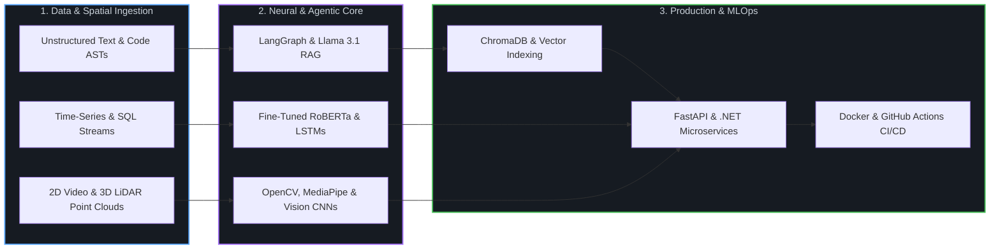
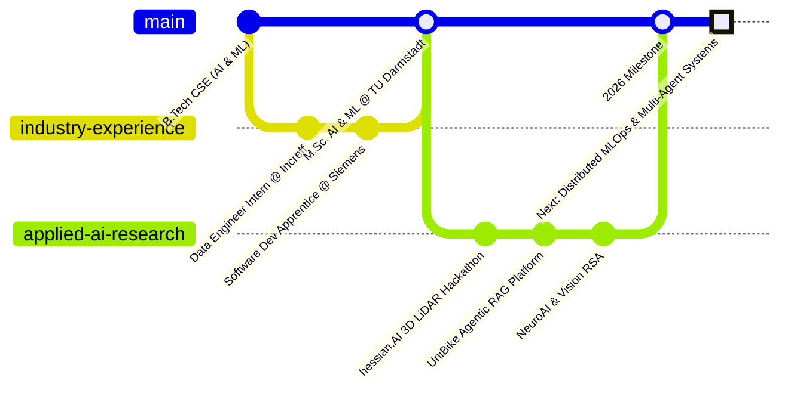

<div align="center">

  <!-- Dynamic Animated SVG Header -->
  <a href="https://github.com/nithinreddy18">
    
  </a>

  <!-- Live Status Pills -->
  <p align="center">
    
    
    
  </p>

  <!-- Quick Connect Buttons -->
  <p align="center">
    <a href="https://www.linkedin.com/in/nithin-reddy-malluri-54198b272/">
      
    </a>
    <a href="https://github.com/nithinreddy18?tab=repositories">
      
    </a>
  </p>

</div>

---

### 🖥️ System Telemetry

```diff
+ SYSTEM ONLINE // nithin-ai-engine v2026.10
===================================================================================
  USER          >> Malluri Nithin Reddy (@nithinreddy18)
  DEGREE        >> M.Sc. in Artificial Intelligence & Machine Learning @ TU Darmstadt
  BACKGROUND    >> Ex-Software Dev Apprentice @ Siemens | Ex-Data Engineer @ Increff
  CORE ENGINE   >> PyTorch, Hugging Face, LangGraph, FastAPI, Docker, C++, SQL
  RESEARCH      >> NeuroAI, 3D Point-Cloud Deep Learning, Multi-Agent RAG
  LOCATION      >> Darmstadt / Frankfurt Rhine-Main Metropolitan Region, Germany
===================================================================================
! STATUS        >> Open to Working Student roles, AI research, and open-source PRs
```

> [!IMPORTANT]
> **Personal Mission Statement**
> To engineer intelligent systems that move beyond experimental notebooks, transforming complex neural architectures and unstructured data into reliable, transparent, and scalable software that solves physical and enterprise challenges.

---

### 🧠 How I Architect Systems

Rather than treating machine learning models as isolated scripts, I build end-to-end pipelines that connect raw data ingestion to low-latency production APIs.



---

### 🛠️ Technical Arsenal

<div align="center">
  
</div>

<br>

<table width="100%">
  <tr>
    <td width="33%" valign="top">
      <h4 align="center">🧬 AI & Deep Learning</h4>
      <p align="center">
        
        
        
        
        
        
        
      </p>
    </td>
    <td width="33%" valign="top">
      <h4 align="center">⚙️ Data & Backend Engineering</h4>
      <p align="center">
        
        
        
        
        
        
        
      </p>
    </td>
    <td width="33%" valign="top">
      <h4 align="center">☁️ Cloud, Frontend & MLOps</h4>
      <p align="center">
        
        
        
        
        
        
      </p>
    </td>
  </tr>
</table>

---

### 🚀 Bento Projects Showcase

<table>
  <tr>
    <td width="50%" valign="top">
      <h3>🚲 UniBike Fleet & Repair Analytics</h3>
      <p>
        
        
        
        
      </p>
      <p>Full-stack smart mobility platform engineered with an autonomous Retrieval-Augmented Generation agent for automated repair diagnostics, fleet telemetry tracking, and predictive maintenance scheduling.</p>
      <details>
        <summary><b>🔍 View Architecture Highlights</b></summary>
        <ul>
          <li>Vectorised maintenance manuals in ChromaDB for sub-second semantic retrieval.</li>
          <li>Built asynchronous REST endpoints in FastAPI with automated CI/CD via GitHub Actions.</li>
        </ul>
      </details>
      <br>
      <a href="https://github.com/nithinreddy18?tab=repositories"><b>📂 Explore Repository →</b></a>
    </td>
    <td width="50%" valign="top">
      <h3>📄 AST-Driven AI Documentation Engine</h3>
      <p>
        
        
        
        
      </p>
      <p>Developer tooling system that parses source code into Abstract Syntax Trees to extract dependency graphs and synthesise context-aware technical documentation automatically.</p>
      <details>
        <summary><b>🔍 View Architecture Highlights</b></summary>
        <ul>
          <li>Eliminates hallucinated function signatures by grounding LLM prompts in deterministic AST node metadata.</li>
          <li>Containerised microservice architecture ready for CI pipeline integration.</li>
        </ul>
      </details>
      <br>
      <a href="https://github.com/nithinreddy18?tab=repositories"><b>📂 Explore Repository →</b></a>
    </td>
  </tr>
  <tr>
    <td width="50%" valign="top">
      <h3>🕵️‍♂️ RoBERTa Synthetic Text Detector</h3>
      <p>
        
        
        
      </p>
      <p>Fine-tuned transformer sequence classification model designed to detect subtle stylometric patterns and separate human writing from LLM-generated prose with 94% validation accuracy.</p>
      <a href="https://github.com/nithinreddy18?tab=repositories"><b>📂 Explore Repository →</b></a>
    </td>
    <td width="50%" valign="top">
      <h3>📦 Hybrid Perishable Inventory Forecaster</h3>
      <p>
        
        
        
      </p>
      <p>Predictive supply-chain engine combining Recurrent Neural Networks with ensemble decision trees to capture both sequential seasonality and non-linear feature interactions for waste reduction.</p>
      <a href="https://github.com/nithinreddy18?tab=repositories"><b>📂 Explore Repository →</b></a>
    </td>
  </tr>
  <tr>
    <td width="50%" valign="top">
      <h3>🖐️ Touchless Gesture Media Controller</h3>
      <p>
        
        
        
      </p>
      <p>Low-latency computer vision interface mapping 21 3D hand-knuckle landmarks in real time to trigger OS media controls with 92% gesture recognition fidelity.</p>
      <a href="https://github.com/nithinreddy18?tab=repositories"><b>📂 Explore Repository →</b></a>
    </td>
    <td width="50%" valign="top">
      <h3>😷 Real-Time Spatial Mask Compliance</h3>
      <p>
        
        
        
      </p>
      <p>High-throughput convolutional vision pipeline built for live video feeds, delivering 95% classification accuracy across variable lighting and occlusion conditions.</p>
      <a href="https://github.com/nithinreddy18?tab=repositories"><b>📂 Explore Repository →</b></a>
    </td>
  </tr>
</table>

---

### ⚡ Engineering & Research Highlights

* **🛰️ 3D LiDAR Industrial AI Challenge (hessian.AI)**
  Built 3D point-cloud deep learning pipelines for automated bunker fill-level estimation and crane waste-mix optimisation during the Waste-to-Energy Industry Challenge Hackathon.
* **🧬 NeuroAI & Biological Vision Alignment**
  Investigating Representational Similarity Analysis using the Net2Brain toolbox at TU Darmstadt to compare deep computer vision backbones against human brain neural recordings.
* **🏢 Enterprise Software Engineering @ Siemens**
  Developed modular C# and C++ backend components alongside Angular user interfaces for industrial software systems.
* **📊 High-Volume Data Engineering @ Increff**
  Architected resilient Python and SQL ETL pipelines to process large-scale retail inventory and merchandising datasets.

---

### 🗺️ Career GitGraph & Learning Roadmap



<table width="100%">
  <tr>
    <td width="50%" valign="top">
      <h4>🎯 Active Learning Goals</h4>
      <ul>
        <li><b>Stateful Multi-Agent Systems</b> Designing cyclical, self-correcting agent graphs with deterministic tool validation in LangGraph.</li>
        <li><b>High-Throughput LLM Serving</b> Implementing AWQ/GGUF quantisation, LoRA fine-tuning, and low-latency inference with vLLM.</li>
        <li><b>Neuro-Symbolic & Brain-Aligned AI</b> Bridging human visual cortex representations with modern Vision Transformers.</li>
      </ul>
    </td>
    <td width="50%" valign="top">
      <h4>🚀 Practical Execution Roadmap</h4>
      <ul>
        <li>✅ <b>Q1–Q2 2026</b> Ship production-ready RAG systems, AST developer tools, and 3D LiDAR spatial models.</li>
        <li>✅ <b>Q3 2026</b> Advance graduate coursework in Probabilistic Graphical Models, NLP, and Computer Vision.</li>
        <li>🔄 <b>Q4 2026</b> Benchmark neural representations with Net2Brain and publish open-source evaluation harnesses.</li>
        <li>⏳ <b>2027 Target</b> Scale distributed multi-GPU model training and contribute to core open-source AI frameworks.</li>
      </ul>
    </td>
  </tr>
</table>

---

### 📈 GitHub Telemetry & Activity

<div align="center">
  
  
</div>

<div align="center">
  
</div>

---

### 🤝 Let's Build Something Intelligent

> [!TIP]
> I am actively looking to collaborate on **AI/ML research projects**, **Working Student or Internship roles in Germany**, and **open-source LLM/Vision tooling**.

<table width="100%">
  <tr>
    <td width="33%" align="center">
      <b>💼 Professional Network</b><br><br>
      <a href="https://www.linkedin.com/in/nithin-reddy-malluri-54198b272/">
        
      </a><br>
      <sub>Fastest response for roles, research, and networking.</sub>
    </td>
    <td width="33%" align="center">
      <b>🐙 Code & Pull Requests</b><br><br>
      <a href="https://github.com/nithinreddy18">
        
      </a><br>
      <sub>Open an issue or discussion on any repository.</sub>
    </td>
    <td width="33%" align="center">
      <b>📍 Current Base</b><br><br>
      <br>
      <sub>Available for on-site, hybrid, and remote engineering.</sub>
    </td>
  </tr>
</table>

<div align="center">
  
</div>
